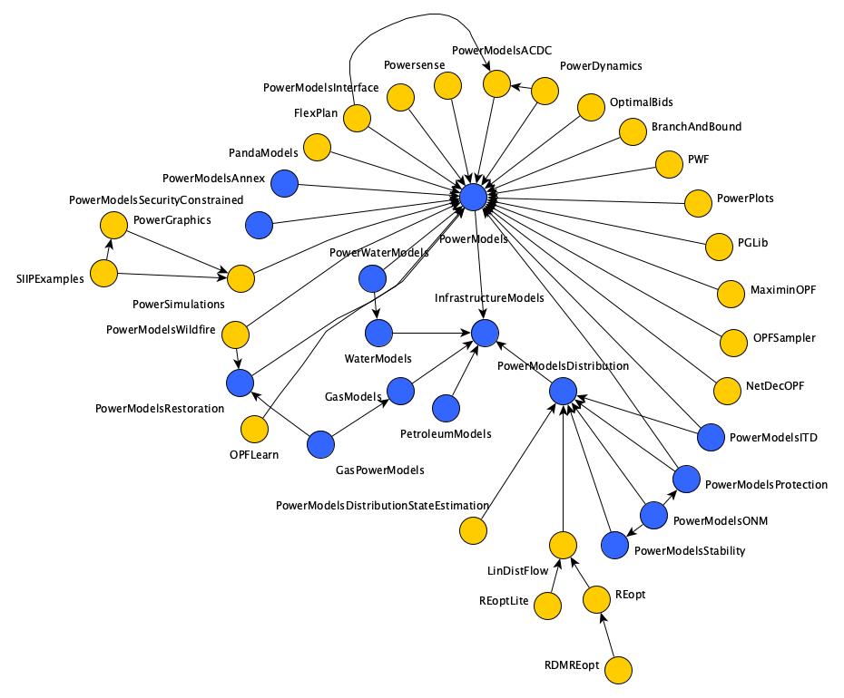

# PowerModelsONM.jl

```@meta
CurrentModule = PowerModelsONM
```

## What is PowerModelsONM?

[PowerModelsONM.jl](https://github.com/lanl-ansi/PowerModelsONM.jl) is a Julia/JuMP-based library for optimizing the operations of networked microgrids under contingencies, in particular unbalanced (i.e., multiconductor) power distribution networks.

## Resources for Getting Started

Read the [Installation Guide](@ref Installation-Guide)

Read the [Quickstart Guide](@ref Quick-Start-Guide)

Read the introductory tutorial [Introduction to PowerModelsONM](@ref Introduction-to-PowerModelsONM)

## How the documentation is structured

The following is a high-level overview of how our documetation is structured. There are three primary sections:

- The **Manual** contains detailed documentation for certain aspects of PowerModelsONM, such as

- **Tutorials** contains working examples of how to use PowerModelsONM. Start here if you are new to PowerModelsONM.

- The **API Reference** contains a complete list of the functions you can use in PowerModelsONM. Look here if you want to know how to use a particular function.

## PowerModelsONM Analyses Packages

PowerModelsONM depends on several other PowerModels(...) packages from the InfrastructureModels ecosystem. The packages in blue below are created and maintained by the core InfrastructureModels developer team, and the other packages are those that are built as extensions or rely on one of the core InfrastructureModels packages in some way.



### PowerModelsDistribution

[PowerModelsDistribution.jl](https://github.com/lanl-ansi/PowerModelsDistribution.jl) is a Julia/JuMP-based package for modeling unbalanced (i.e., multiconductor) power networks. This is the primary modeling framework utilized in PowerModelsONM, and contains the primary logic for optimization and parsing of network data.

### PowerModelsProtection

[PowerModelsProtection.jl](https://github.com/lanl-ansi/PowerModelsProtection.jl) is a Julia/JuMP-based package for performing fault studies on both transmission (via extentions to [PowerModels.jl](https://github.com/lanl-ansi/PowerModels.jl)) and distribution (via extensions to [PowerModelsDistribution.jl](https://github.com/lanl-ansi/PowerModelsDistribution.jl)). In the future, the goal is to include optimal protection coordination formulations and constraints for optimal switching problems.

PowerModelsONM utilizes PowerModelsProtection to perform fault analysis after optimizing the switch configurations and dispatch by using an unbalanced IVR formuation.

### Small signal stability (removed)

Earlier versions of PowerModelsONM reported whether the network configuration at each timestep was small signal stable, using [PowerModelsStability.jl](https://github.com/lanl-ansi/PowerModelsStability.jl). That analysis ran after the optimization and did not affect it, so it has been removed. PowerModelsStability is no longer actively maintained, and its latest release only supports PowerModelsDistribution v0.16. If you still need small signal stability results, use PowerModelsStability directly on the per-timestep networks produced by PowerModelsONM. The `inverters` input and the `stability-*` settings are ignored with a warning, and `"stability"` in `options/problem/skip` is accepted but has no effect.

## License

This code is provided under a BSD license as part of the Multi-Infrastructure Control and Optimization Toolkit (MICOT) project, LA-CC-13-108.
